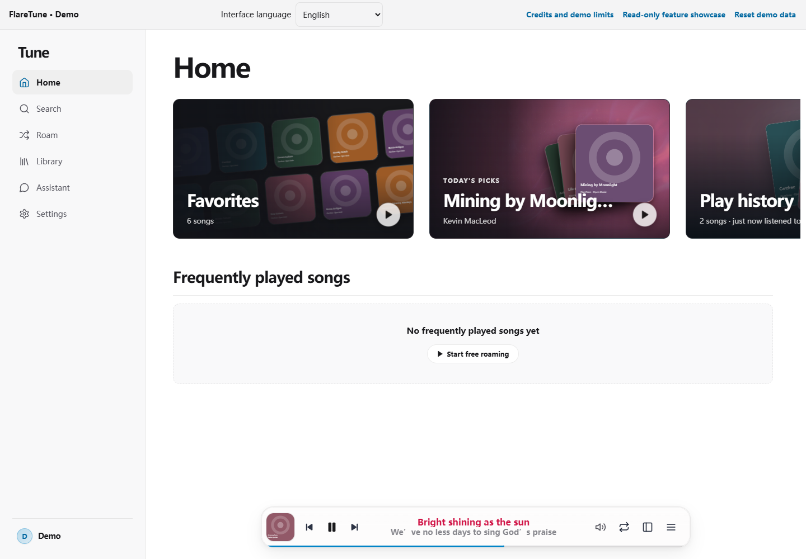
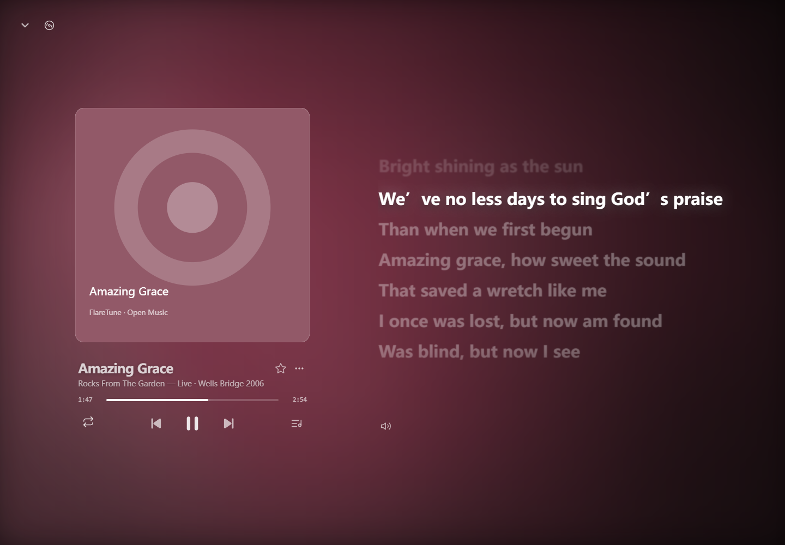
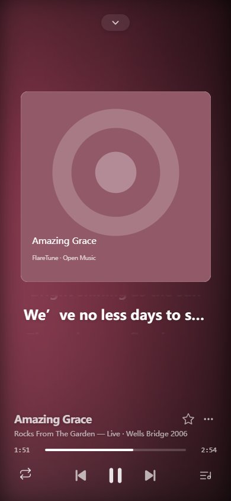

#  FlareTune

[简体中文](README.md) · [English](README.en.md) · [繁體中文](guide/quickstart.zh-Hant.md) · [日本語](guide/quickstart.ja.md) · [한국어](guide/quickstart.ko.md) · [Español](guide/quickstart.es.md) · [Français](guide/quickstart.fr.md) · [Deutsch](guide/quickstart.de.md) · [Português (Brasil)](guide/quickstart.pt-BR.md)

**不用买 VPS，把自己的音乐放进随时可听的私人曲库。**

FlareTune 把网页播放器、账号与曲库服务放在 Cloudflare Workers，元信息放在 D1，音频和封面放在私有 R2。无需运行一台常开的服务器，电脑和手机打开网页就能听自己的收藏，也可以给家人创建独立账号。

Cloudflare R2 Standard 每月提供 **10 GB-month 免费存储额度**，可以作为小型私人曲库的起点；Workers、D1 和存储操作也各有免费额度。能否保持零费用取决于账号总用量、请求量及可选服务，见[免费额度与费用](guide/deployment.md#免费额度与费用)。需要自行开通 Cloudflare/R2、完成初始化并导入有权使用的音频。

**[打开在线 Demo](https://flaretune-demo.arctan.workers.dev)** · [部署自己的曲库](#部署自己的曲库) · [使用指南](guide/using-flaretune.md) · [更新日志](CHANGELOG.md)

## 先听一会儿

Demo 免登录，使用可公开再分发的音乐。播放、搜索、漫游、收藏和个人歌单都能体验；收藏、历史及偏好只保存在当前浏览器。AI、入库和实例管理提供明确标识的只读案例，完整能力由自己的实例提供。素材许可和具体边界见 [Demo 说明](guide/demo.md)。

| 全屏播放器 | 手机界面 |
| --- | --- |
|  |  |

## 日常听歌，也方便管理

- **自己的曲库**：按歌曲、歌手和专辑搜索，按音乐语言漫游。每日推荐目标 20 首，首页预览最多 8 首；曲库不足时展示实际数量，可以手动换一批。
- **认真做的播放器**：播放队列、循环和随机模式、桌面与手机全屏布局，以及逐行/逐字同步歌词。歌词效果取决于可用歌词素材；支持的音频格式取决于浏览器，不提供服务器转码。
- **每个人自己的收藏**：账号收藏和歌单由实例保存，可在不同设备使用；最近播放记录保存在当前浏览器，不承诺跨设备同步。
- **从已有文件开始**：网页上传、曲目信息、封面和歌词管理；大量本地文件可通过[入库设备](tooling/ingest-agent/README.md)扫描、预览、核对重复后导入。
- **可选的音乐助手**：配置自己的模型供应商后，让「小A」帮忙找歌、回答曲库问题和整理歌单。不配置 AI 也能正常听歌。
- **按自己的习惯使用**：九种界面语言、浅色/深色主题、背景与播放器偏好；可选 [Google 登录](guide/google-login.md)和 [Subsonic 客户端](guide/subsonic.md)。

## 为什么选择这种部署方式

如果你想要个人或家庭音乐库，又不想维护 VPS、容器和常驻进程，FlareTune 提供了一套围绕 Cloudflare 的选择。你持有自己的账号、D1 数据库和私有 R2 存储桶；正常实例的业务接口与媒体需要认证。

核心部署不依赖额外服务器。AI、Google 登录及第三方歌词/图片来源是可选的外部服务，可能有自己的费用或可用性限制。FlareTune 面向自有音频的收听与整理，不随正式实例提供商业歌曲资源，也不替代大型影音服务器的转码能力。

## 部署自己的曲库

1. 准备 Cloudflare 账号并开通 R2，在向导中创建/绑定 Worker、空 D1 和私有 R2。
2. 填写并妥善保存至少 32 字符的随机 `SETUP_SECRET`。
3. 部署完成后打开网址，验证密钥、创建首个管理员，然后导入音乐。

公开模板提供部署入口，首次初始化在应用内完成，无需手工运行数据库迁移。完整步骤、手动部署、费用、备份和升级见[部署指南](guide/deployment.md)。全新 Cloudflare 账号的向导行为以平台实际提示为准。

## 文档与贡献

| 入口 | 内容 |
| --- | --- |
| [使用指南](guide/using-flaretune.md) | 播放、漫游、歌单、助手、语言与外观 |
| [管理与维护](guide/administration.md) | 曲库、账号、实例配置与数据维护 |
| [部署与初始化](guide/deployment.md) | 安装、免费额度、密钥、备份与升级 |
| [Demo](guide/demo.md) | 浏览器数据、只读边界、素材来源与复现 |
| [本地开发](guide/local-development.md) | React/Vite/Workers 开发与验证 |
| [全部文档](guide/README.md) | 用户、管理员和客户端文档索引 |
| [参与贡献](CONTRIBUTING.md) | 代码、翻译、设计、测试与问题反馈 |

FlareTune 源自我的个人音乐播放器「乐境」，经过一年多的迭代后作为独立开源项目继续发展。欢迎通过 [GitHub Issues](https://github.com/arctan303/FlareTune/issues) 反馈可复现的问题，或参与代码、设计、翻译和文档贡献。

代码与原创文档采用 [MIT](LICENSE)；协议 MD5 实现保留 [Apache-2.0](licenses/legacy-flaretune-Apache-2.0.txt)。第三方歌曲、照片和品牌素材按[各自许可](ASSETS.md)使用，MIT 不覆盖这些内容。
