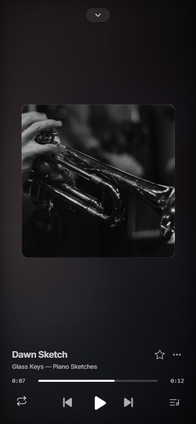

# Using FlareTune

[简体中文](using-flaretune.md) · [English](using-flaretune.en.md)

FlareTune works with a music library maintained by your instance administrator. The administrator imports songs and creates member accounts; members can then listen, organize personal playlists, and use enabled assistant features.

Before deploying, try the player, playlists and settings in the [live demo](https://flaretune.arcinks.com), with no sign-in. Demo personal data stays in your browser and the assistant returns a fixed example; see [demo details](demo.en.md).

## Find and play music

- **Home** shows library content, recent listening, and quick playback entry points.
- **Search** finds imported songs, artists, and albums.
- **Roam** plays a changing selection from the library.
- **Player** keeps your queue and playback position. Open it full screen and switch between classic cover art and artist photos. Available lyrics follow playback.

The instance administrator maintains the library. FlareTune does not automatically supply audio for songs that are absent from it.

Today's picks contains up to 20 playable songs, with up to 8 in the Home preview. Smaller libraries show their actual count. The selection updates on your first visit each day using your device's local date; choose “Refresh selection” in the detail view to get another batch. Each browser keeps a separate selection for each instance and account, so devices may receive different picks. Updating preserves playback and your queue; failures keep the previous selection available for retry.

Roam categories describe song languages, with instrumental music listed separately; they are not genres. “Turn off roam” stops automatic additions to the queue while the current song keeps playing. Small libraries may repeat recent songs.

Desktop and mobile share the same library but use layouts suited to each screen. The image below shows a player with fictional local tracks. The [project screenshots](../README.en.md#try-it-with-music) show more desktop and mobile views.

## Favorites and library

Use the star on a song to add or remove it from Favorites. You can also create personal playlists, add songs, change track order, and arrange playlist order in your library. Favorites, playlists, and play statistics belong to your account; other members cannot directly see or change your personal lists.

## Music assistant

Open Assistant from the sidebar to ask about the library or the currently playing song. The assistant can find and queue songs and help organize your playlists. Actions such as deleting an entire playlist require confirmation in the page. The instance administrator chooses the AI model; playback and the personal library work independently when the model is unavailable.

Click Stop during generation. An unfinished turn with an empty composer offers Continue; you can also enter a new request. Received answers, thought progress and tool results are retained, and successful actions are not automatically repeated on continuation. Drafts and attachments survive switching to memory and back; signing out or changing accounts clears them.

Memory is off by default. When enabled, the assistant can save lasting information and preferences, list entries, update, delete or merge them. Deleting or merging reclaims the 30-entry capacity. Changing play counts and rankings are queried through tools. Entries you manually edit remain under your control and cannot be overwritten or deleted by the assistant. Disabling memory stops assistant access and maintenance while retaining saved entries.

## Appearance and personal settings

In Settings, follow the system appearance or choose light or dark mode, a background, and a player style. Personal settings show account details and password controls. Recent listening history stays in the current browser. You can set the interface language for your account to Follow browser or any of five languages (Chinese in both scripts, English, Japanese and Korean); the choice follows your account across devices. Before sign-in, pages follow the browser language, with English as the fallback for unsupported languages. Administrators also see library, accounts, AI, and instance settings; members do not see these admin areas.

## Lyrics and translation

The player reads lyrics saved by the instance and shows synchronized source lyrics and translations when available. Administrators can use the lyrics workspace to review sources, correct lyrics and timing, and apply AI translation according to instance settings. Saved shared lyrics are available to members. The interface language does not translate song titles, lyrics, or user content.

The player automatically searches when a song has no saved lyrics, preferring word timing when the recording and duration match reliably. Manual search supports source, timing and translation filters. Timing and translation require inspecting candidate contents; continue checking remaining candidates or retry failed inspections. Edited search text takes effect when you search again. Selecting a candidate creates a draft; saving applies it.

Custom sources appear first in the candidate list. A rate-limited source shows a reason and countdown, with a retry for that source when the wait ends; other candidates and loaded previews remain available. Retrying uses the last submitted search, without applying unsubmitted edits or sending an automatic request when the countdown ends. See [lyric sources and request limits](lyric-sources.en.md).

New automatically saved plain or line-timed lyrics can be checked for an upgrade in the background on later reads, at most once per song every six hours. A reliable higher-precision result takes effect on the next playback, keeping the current playback stable. Manually selected, imported, edited, shifted or restored lyrics are protected, as are older lyrics whose editing history cannot be established.

## Installation

See the [deployment guide](deployment.en.md) for new-instance setup.
